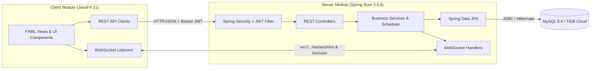

# TECH AUCTION — Nền Tảng Đấu Giá Trực Tuyến Thời Gian Thực

> **Bài tập lớn môn Lập trình Nâng cao — Nhóm 10**  
> Hệ thống đấu giá trực tuyến đa người dùng theo kiến trúc Client–Server hiện đại, tích hợp cập nhật giá thời gian thực qua WebSocket, cơ chế chống đặt giá phút chót (Anti-Sniping), ví điện tử nội bộ và quản trị tập trung.

---

## Mục lục

1. [Giới thiệu sản phẩm](#1-giới-thiệu-sản-phẩm)
2. [Tính năng nổi bật](#2-tính-năng-nổi-bật)
3. [Kiến trúc hệ thống & Công nghệ](#3-kiến-trúc-hệ-thống--công-nghệ)
4. [Cấu trúc thư mục dự án](#4-cấu-trúc-thư-mục-dự-án)
5. [Sơ đồ lớp (Class Diagram) từng module](#5-sơ-đồ-lớp-class-diagram-từng-module)
   - [5.1. Module `shared` (Domain Models, Enums & DTOs)](#51-module-shared-domain-models-enums--dtos)
   - [5.2. Module `server` (Backend Spring Boot)](#52-module-server-backend-spring-boot)
   - [5.3. Module `client` (Desktop App JavaFX)](#53-module-client-desktop-app-javafx)
6. [Danh sách REST API & WebSocket Endpoints](#6-danh-sách-rest-api--websocket-endpoints)
7. [Hướng dẫn cài đặt & Chạy ứng dụng](#7-hướng-dẫn-cài-đặt--chạy-ứng-dụng)
8. [Kịch bản kiểm thử luồng nghiệp vụ](#8-kịch-bản-kiểm-thử-luồng-nghiệp-vụ)
9. [Kiểm thử tự động (Automated Testing)](#9-kiểm-thử-tự-động-automated-testing)

---

## 1. Giới thiệu sản phẩm

**TECH AUCTION** là ứng dụng đấu giá trực tuyến cho phép người dùng niêm yết sản phẩm, tổ chức các phiên đấu giá công khai và tham gia đặt giá cạnh tranh theo thời gian thực. Hệ thống được thiết kế tách biệt rõ ràng thành 3 module độc lập trên nền tảng **Java 21 & Maven Multi-Module**:

- **`shared`**: Thư viện lõi dùng chung giữa Client và Server, đảm bảo tính nhất quán dữ liệu thông qua hệ thống đối tượng miền (Domain Models), kiểu liệt kê trạng thái (Enums) và các gói truyền tải dữ liệu (DTOs).
- **`server`**: Dịch vụ Backend xây dựng trên **Spring Boot 3.5**, chịu trách nhiệm xác thực bảo mật, xử lý giao dịch đặt giá đồng thời, tự động đóng phiên theo lịch trình và phát sự kiện thời gian thực.
- **`client`**: Ứng dụng Desktop đa nền tảng xây dựng trên **JavaFX 21**, cung cấp giao diện trực quan với biểu đồ biến động giá, thông báo tức thì, trò chuyện trực tiếp và hỗ trợ song ngữ Việt – Anh.

### Phân quyền người dùng

| Vai trò (`UserRole`) | Mô tả quyền hạn |
| :--- | :--- |
| **`BIDDER`** (Người mua) | Duyệt danh sách vật phẩm/phiên đấu giá, nạp/rút ví, đặt giá trực tuyến, theo dõi phiên/người bán và nhắn tin trao đổi. |
| **`SELLER`** (Người bán) | Bao gồm các quyền cơ bản và bổ sung quyền tạo/chỉnh sửa vật phẩm, gửi yêu cầu kiểm duyệt và mở phiên đấu giá mới (không được tự đặt giá vật phẩm của chính mình). |
| **`ADMIN`** (Quản trị viên) | Kiểm duyệt hoặc từ chối vật phẩm mới, quản lý trạng thái/phân quyền người dùng, giám sát, ẩn hoặc dừng khẩn cấp các phiên đấu giá. |

---

## 2. Tính năng nổi bật

- **Xác thực & Bảo mật đa lớp**:
  - Đăng ký tài khoản kèm xác thực mã **OTP 6 số** (hỗ trợ gửi qua SMTP Email hoặc xuất trực tiếp ra Console để phát triển/kiểm thử), giới hạn tần suất gửi lại (cooldown) và số lần nhập sai tối đa.
  - Đăng nhập truyền thống (mã hóa mật khẩu bằng **BCrypt**) hoặc **Google OAuth2**, cấp phát **JWT (JSON Web Token)** cho mọi yêu cầu REST API và kết nối WebSocket.
  - Quy trình Quên mật khẩu & Đặt lại mật khẩu an toàn qua OTP.
- **Đấu giá thời gian thực & Chống Sniping (Anti-Sniping)**:
  - Cập nhật giá cao nhất, người dẫn đầu và lịch sử đặt giá tức thì tới toàn bộ người dùng đang theo dõi qua kênh WebSocket `/ws/auctions`.
  - **Cơ chế gia hạn tự động**: Nếu có lượt đặt giá hợp lệ trong **10 giây cuối** của phiên, hệ thống tự động gia hạn thêm **60 giây** (có thể lặp lại nhiều lần) để đảm bảo tính công bằng.
  - Tiến trình nền (`AuctionScheduler`) tự động quét, chốt phiên hết hạn và xác định người thắng cuộc.
- **Ví điện tử & Quản lý giao dịch**:
  - Hỗ trợ nạp tiền (`deposit`), rút tiền (`withdraw`), kiểm tra số dư và tra cứu lịch sử biến động số dư chi tiết.
- **Tương tác xã hội & Trải nghiệm người dùng**:
  - **Theo dõi (Watch & Follow)**: Theo dõi phiên đấu giá cụ thể (kèm tùy chọn tắt âm thông báo) hoặc theo dõi người bán yêu thích.
  - **Thông báo & Chat P2P Realtime**: Kênh WebSocket riêng `/ws/user` đẩy thông báo biến động giá, kết quả phiên và tin nhắn trực tiếp giữa người mua – người bán.
  - **Trực quan hóa & Đa ngôn ngữ**: Biểu đồ lịch sử giá (`BidHistoryChart`) và chuyển đổi linh hoạt Tiếng Việt / Tiếng Anh (`I18n`).

---

## 3. Kiến trúc hệ thống & Công nghệ



| Thành phần | Công nghệ / Thư viện | Phiên bản |
| :--- | :--- | :--- |
| **Ngôn ngữ & Build** | Java (JDK), Apache Maven Multi-Module | Java 21, Maven 3.9+ |
| **Backend Framework** | Spring Boot (Web, Data JPA, Security, WebSocket, Mail, OAuth2 Client) | 3.5.6 |
| **Bảo mật & Token** | JJWT (`jjwt-api`, `jjwt-impl`, `jjwt-jackson`), BCrypt | 0.12.6 |
| **Cơ sở dữ liệu** | MySQL (`mysql-connector-j`), H2 In-Memory (cho Unit/Integration Test) | MySQL 8.4+ |
| **Giao diện Desktop** | JavaFX (`javafx-controls`, `javafx-fxml`), JSVG | JavaFX 21.0.7, JSVG 1.6.1 |
| **HTTP & JSON Client** | Java `HttpClient`, Spring Web, Jackson (`jackson-databind`, `jsr310`) | Jackson 2.17.2 |
| **Đóng gói & Triển khai** | Docker Multi-stage Build (`eclipse-temurin:21`) | JRE 21 |

---

## 4. Cấu trúc thư mục dự án

```text
BaiTapLon-Ltnc-nhom10vip-dev/
├── .gitignore
├── Dockerfile                                               # Đóng gói container cho module server
├── README.md                                                # Tài liệu giới thiệu & hướng dẫn dự án
├── pom.xml                                                  # Maven Parent POM quản lý 3 module con
├── config/
│   └── application-local.example.properties                 # Mẫu cấu hình kết nối MySQL local
├── data/
│   ├── auction.mv.db                                        # File dữ liệu H2 local (nếu dùng)
│   └── auction.trace.db                                     # File trace log của H2
├── database/
│   └── mysql-setup.sql                                      # Script SQL khởi tạo database auction
├── docs/
│   └── MYSQL.md                                             # Hướng dẫn cài đặt MySQL local, LAN & Cloud
├── shared/                                                  # Module dùng chung (Models, Enums, DTOs)
│   ├── pom.xml
│   └── src/main/java/vn/edu/auction/shared/
│       ├── dto/                                             # Request/Response DTOs & ExtraDto records
│       │   ├── ApiErrorResponse.java
│       │   ├── AuctionRequest.java
│       │   ├── AuctionResponse.java
│       │   ├── AuthResponse.java
│       │   ├── BidResponse.java
│       │   ├── EmailRequest.java
│       │   ├── ExtraDto.java
│       │   ├── ItemRequest.java
│       │   ├── ItemResponse.java
│       │   ├── LoginRequest.java
│       │   ├── MessageResponse.java
│       │   ├── PlaceBidRequest.java
│       │   ├── RegisterRequest.java
│       │   ├── ResetPasswordRequest.java
│       │   └── VerifyOtpRequest.java
│       ├── enums/                                           # Các kiểu liệt kê trạng thái hệ thống
│       │   ├── AuctionStatus.java
│       │   ├── BidStatus.java
│       │   ├── ItemStatus.java
│       │   ├── UserRole.java
│       │   └── UserStatus.java
│       └── model/                                           # Các lớp đối tượng miền (Domain Models)
│           ├── Admin.java
│           ├── Auction.java
│           ├── BidTransaction.java
│           ├── Bidder.java
│           ├── Item.java
│           ├── Seller.java
│           └── User.java
├── server/                                                  # Module Backend Spring Boot
│   ├── pom.xml
│   └── src/
│       ├── main/
│       │   ├── java/vn/edu/auction/server/
│       │   │   ├── MainApplication.java                     # Điểm khởi chạy Spring Boot Server
│       │   │   ├── config/                                  # Cấu hình Security, WebSocket, Clock
│       │   │   │   ├── AuctionTimeConfig.java
│       │   │   │   ├── SecurityConfig.java
│       │   │   │   └── WebSocketConfig.java
│       │   │   ├── controller/                              # Các REST API Controller
│       │   │   │   ├── AccountController.java
│       │   │   │   ├── AdminController.java
│       │   │   │   ├── AuctionController.java
│       │   │   │   ├── AuctionPrincipal.java
│       │   │   │   ├── AuthController.java
│       │   │   │   ├── BidController.java
│       │   │   │   ├── HealthController.java
│       │   │   │   ├── ItemController.java
│       │   │   │   └── SocialController.java
│       │   │   ├── entity/                                  # Các JPA Entity ánh xạ bảng CSDL
│       │   │   │   ├── AuctionEntity.java
│       │   │   │   ├── AuctionWatchEntity.java
│       │   │   │   ├── BidTransactionEntity.java
│       │   │   │   ├── ChatMessageEntity.java
│       │   │   │   ├── ItemEntity.java
│       │   │   │   ├── NotificationEntity.java
│       │   │   │   ├── OtpEntity.java
│       │   │   │   ├── OtpPurpose.java
│       │   │   │   ├── UserEntity.java
│       │   │   │   ├── UserFollowEntity.java
│       │   │   │   └── WalletTransactionEntity.java
│       │   │   ├── event/                                   # WebSocket Handlers & Spring Events
│       │   │   │   ├── AuctionEvent.java
│       │   │   │   ├── AuctionEventPublisher.java
│       │   │   │   ├── BidAcceptedEvent.java
│       │   │   │   └── UserSocketHandler.java
│       │   │   ├── exception/                               # Ngoại lệ nghiệp vụ & Global Handler
│       │   │   │   ├── AccountNotActiveException.java
│       │   │   │   ├── AuctionApiExceptionHandler.java
│       │   │   │   ├── AuctionBusinessException.java
│       │   │   │   ├── DuplicateEmailException.java
│       │   │   │   ├── EmailSendException.java
│       │   │   │   ├── GlobalExceptionHandler.java
│       │   │   │   ├── InvalidCredentialsException.java
│       │   │   │   ├── InvalidOtpException.java
│       │   │   │   └── OtpCooldownException.java
│       │   │   ├── repository/                              # Spring Data JPA Repositories
│       │   │   │   ├── AuctionRepository.java
│       │   │   │   ├── AuctionWatchRepository.java
│       │   │   │   ├── BidTransactionRepository.java
│       │   │   │   ├── ChatMessageRepository.java
│       │   │   │   ├── ItemRepository.java
│       │   │   │   ├── NotificationRepository.java
│       │   │   │   ├── OtpRepository.java
│       │   │   │   ├── UserFollowRepository.java
│       │   │   │   ├── UserRepository.java
│       │   │   │   └── WalletTransactionRepository.java
│       │   │   ├── security/                                # Xác thực & tạo/kiểm tra JWT
│       │   │   │   ├── JwtAuthenticationFilter.java
│       │   │   │   └── JwtService.java
│       │   │   └── service/                                 # Tầng xử lý nghiệp vụ & Scheduler
│       │   │       ├── AccountService.java
│       │   │       ├── AdminService.java
│       │   │       ├── AuctionClosingService.java
│       │   │       ├── AuctionRules.java
│       │   │       ├── AuctionScheduler.java
│       │   │       ├── AuctionService.java
│       │   │       ├── AuctionUserService.java
│       │   │       ├── AuthService.java
│       │   │       ├── BidService.java
│       │   │       ├── ItemService.java
│       │   │       ├── MailService.java
│       │   │       ├── OtpService.java
│       │   │       └── SocialService.java
│       │   └── resources/                                   # File cấu hình Spring Boot
│       │       ├── application.properties
│       │       ├── application-google.properties
│       │       └── application-mail.properties
│       └── test/java/vn/edu/auction/server/                 # Bộ kiểm thử tự động (JUnit 5 + H2)
│           ├── AdminPromotionTest.java
│           ├── P3BackendTest.java
│           └── service/
│               └── BidServiceTest.java
└── client/                                                  # Module Ứng dụng Desktop JavaFX
    ├── pom.xml
    └── src/main/
        ├── java/vn/edu/auction/client/
        │   ├── AppLauncher.java                             # Wrapper khởi chạy ứng dụng JavaFX
        │   ├── I18n.java                                    # Quản lý đa ngôn ngữ Việt / Anh
        │   ├── Main.java                                    # JavaFX Application chính
        │   ├── api/                                         # REST API Clients & WebSocket Listeners
        │   │   ├── AdminApiClient.java
        │   │   ├── AuctionApiClient.java
        │   │   ├── AuctionRealtimeClient.java
        │   │   ├── AuthApiClient.java
        │   │   ├── BaseApiClient.java
        │   │   ├── BidApiClient.java
        │   │   ├── FxAsync.java
        │   │   ├── ItemApiClient.java
        │   │   ├── UserApiClient.java
        │   │   └── UserSocketClient.java
        │   ├── auction/                                     # Controller & dữ liệu chi tiết phiên
        │   │   ├── AuctionDetailController.java
        │   │   ├── AuctionMockData.java
        │   │   ├── AuctionResultController.java
        │   │   └── BidHistoryController.java
        │   ├── auth/                                        # Xử lý đăng nhập, đăng ký, OTP
        │   │   ├── AuthController.java
        │   │   └── RegisterData.java
        │   ├── browse/                                      # Khám phá danh sách & chi tiết đấu giá
        │   │   ├── AuctionDetailController.java
        │   │   ├── AuctionListController.java
        │   │   ├── BrowseController.java
        │   │   ├── DemoBidHistory.java
        │   │   └── ItemListController.java
        │   ├── controller/                                  # Điều hướng & quản lý vật phẩm
        │   │   ├── HomeController.java
        │   │   ├── ItemManagementController.java
        │   │   ├── ItemMock.java
        │   │   └── NavigationController.java
        │   ├── model/                                       # Trạng thái phiên đăng nhập Client
        │   │   └── SessionData.java
        │   ├── navigation/                                  # Điều phối chuyển cảnh FXML
        │   │   └── Navigator.java
        │   └── ui/                                          # Các thành phần UI tái sử dụng & Dialog
        │       ├── AdminStage.java
        │       ├── BellButton.java
        │       ├── BidHistoryChart.java
        │       ├── ChatWindow.java
        │       ├── ProfileDialog.java
        │       ├── UiKit.java
        │       ├── UiTheme.java
        │       ├── UserArea.java
        │       ├── WalletDialog.java
        │       └── WatchBar.java
        └── resources/vn/edu/auction/client/
            ├── css/                                         # Stylesheet giao diện JavaFX
            │   ├── app.css
            │   ├── auction.css
            │   ├── auth.css
            │   ├── browse.css
            │   └── theme.css
            ├── fxml/                                        # Các tệp bố cục giao diện FXML
            │   ├── home-view.fxml
            │   ├── item-management-view.fxml
            │   ├── auction/
            │   │   ├── auction-detail-view.fxml
            │   │   ├── auction-result-view.fxml
            │   │   └── bid-history-view.fxml
            │   ├── auth/
            │   │   ├── login-view.fxml
            │   │   ├── otp-verification-view.fxml
            │   │   ├── register-view.fxml
            │   │   ├── reset-password-view.fxml
            │   │   ├── reset-password2-view.fxml
            │   │   └── signup-method-view.fxml
            │   ├── browse/
            │   │   ├── auction-list-view.fxml
            │   │   ├── browse-view.fxml
            │   │   └── item-list-view.fxml
            │   └── home/
            │       ├── home-view.fxml
            │       └── item-management-view.fxml
            ├── i18n/                                        # Gói tài nguyên ngôn ngữ
            │   ├── messages_en.properties
            │   └── messages_vi.properties
            └── icons/                                       # Biểu tượng & tài nguyên đồ họa
                ├── Face_circle.png
                ├── Facebook.png
                ├── eye-off.svg
                ├── eye.svg
                ├── gglogo.png
                ├── linkedIn.png
                └── linkedIn_circle.png
