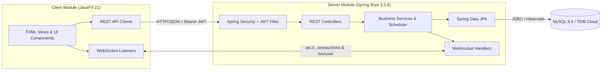

# Bidora. — Nền Tảng Đấu Giá Trực Tuyến Thời Gian Thực

## Xem thử giao diện trên máy

Ở chế độ kết nối server, khách có thể tìm phiên, xem giá và lịch sử đặt giá. Khi khách bấm **Đặt giá**, Bidora mở đăng nhập và đưa họ về phiên để kiểm tra giá rồi xác nhận.

Từ thư mục gốc của repository, chạy `mvn "-Dmaven.repo.local=../.m2/repository" -pl client "-Djavafx.args=--preview" javafx:run`. Ứng dụng tự mở tài khoản **Tài khoản xem thử** với dữ liệu tạm trong bộ nhớ. Có thể xem danh sách phiên, đặt giá, ví, hồ sơ và chat. Đóng ứng dụng sẽ xóa dữ liệu xem thử. Nhãn “Xem thử cục bộ” ở thanh trên cho biết đang dùng chế độ này.

Chế độ xem thử chạy trên `127.0.0.1` và không kết nối TiDB. Để kiểm tra cập nhật giá, thông báo và chat giữa nhiều tài khoản, chạy server thật với database rồi đăng nhập bằng các tài khoản thật.

Nhấn **EN** hoặc **VI** trên thanh điều hướng để đổi ngôn ngữ trong khi đang xem phiên. Nút mặt trời/mặt trăng kế bên hỗ trợ nhấn hoặc dùng phím Space khi có tiêu điểm. Bidora ghi nhớ ngôn ngữ và giao diện sáng/tối cho lần mở sau.

Phần UI/UX của nhóm dùng nhánh `feature/p3.uiux.playground`. Khi thêm nội dung giao diện, khai báo cùng một khóa trong `messages_vi.properties` và `messages_en.properties`. Trong FXML dùng `I18n.caption="wallet.balance"` cho nhãn và `I18n.prompt="browse.search"` cho gợi ý nhập. Dữ liệu sản phẩm và nội dung chat giữ nguyên lời người dùng.

> **Bài tập lớn môn Lập trình Nâng cao — Nhóm 10**  
> Hệ thống đấu giá trực tuyến đa người dùng theo kiến trúc Client–Server hiện đại, tích hợp cập nhật giá thời gian thực qua WebSocket, cơ chế chống đặt giá phút chót (Anti-Sniping), ví điện tử nội bộ và quản trị tập trung.

---

## Mục lục

1. [Giới thiệu sản phẩm](#1-giới-thiệu-sản-phẩm)
2. [Tính năng nổi bật](#2-tính-năng-nổi-bật)
3. [Kiến trúc hệ thống & Công nghệ](#3-kiến-trúc-hệ-thống--công-nghệ)
4. [Cấu trúc thư mục dự án](#4-cấu-trúc-thư-mục-dự-án)
5. [Sơ đồ lớp (Class Diagram) từng module](#5-sơ-đồ-lớp-class-diagram-từng-module)
   - [5.1. Module `shared` (Domain Models, Enums & DTOs)](#51-module-shared-domain-models-enums--dtos)
   - [5.2. Module `server` (Backend Spring Boot)](#52-module-server-backend-spring-boot)
   - [5.3. Module `client` (Desktop App JavaFX)](#53-module-client-desktop-app-javafx)
6. [Danh sách REST API & WebSocket Endpoints](#6-danh-sách-rest-api--websocket-endpoints)
7. [Hướng dẫn cài đặt & Chạy ứng dụng](#7-hướng-dẫn-cài-đặt--chạy-ứng-dụng)
8. [Kịch bản kiểm thử luồng nghiệp vụ](#8-kịch-bản-kiểm-thử-luồng-nghiệp-vụ)
9. [Kiểm thử tự động (Automated Testing)](#9-kiểm-thử-tự-động-automated-testing)

---

## 1. Giới thiệu sản phẩm

**Bidora.** là ứng dụng đấu giá trực tuyến cho phép người dùng niêm yết sản phẩm, tổ chức các phiên đấu giá công khai và tham gia đặt giá cạnh tranh theo thời gian thực. Hệ thống được thiết kế tách biệt rõ ràng thành 3 module độc lập trên nền tảng **Java 21 & Maven Multi-Module**:

- **`shared`**: Thư viện lõi dùng chung giữa Client và Server, đảm bảo tính nhất quán dữ liệu thông qua hệ thống đối tượng miền (Domain Models), kiểu liệt kê trạng thái (Enums) và các gói truyền tải dữ liệu (DTOs).
- **`server`**: Dịch vụ Backend xây dựng trên **Spring Boot 3.5**, chịu trách nhiệm xác thực bảo mật, xử lý giao dịch đặt giá đồng thời, tự động đóng phiên theo lịch trình và phát sự kiện thời gian thực.
- **`client`**: Ứng dụng Desktop đa nền tảng xây dựng trên **JavaFX 21**, cung cấp giao diện trực quan với biểu đồ biến động giá, thông báo tức thì, trò chuyện trực tiếp và hỗ trợ song ngữ Việt – Anh.

### Phân quyền người dùng

| Vai trò (`UserRole`) | Mô tả quyền hạn |
| :--- | :--- |
| **`BIDDER`**, **`SELLER`** | Cùng được đăng bán, mở phiên sau khi duyệt và đặt giá ở phiên của người khác. Tài khoản mới nhận giá trị `BIDDER`. |
| **`ADMIN`** | Giữ quyền mua bán và có thêm trang quản trị để duyệt sản phẩm, quản lý tài khoản và điều hành phiên. |

Ở **Thông tin tài khoản → Hồ sơ mua và bán**, bật **Tách hồ sơ** để đặt tên, ảnh và giới thiệu riêng. Khi tắt, cả hai hoạt động dùng hồ sơ chung. Người xem mở hồ sơ bán từ chi tiết phiên, hồ sơ mua từ người dẫn đầu hoặc điểm trên biểu đồ giá. Email, mật khẩu, ví và ID chủ sở hữu luôn thuộc cùng một tài khoản. Server so sánh ID từ JWT với ID người bán khi nhận lượt đặt giá.

Nếu quên mật khẩu khi đang đăng nhập, chọn **Thông tin tài khoản → Quên mật khẩu?** để nhận OTP qua email và quay về tài khoản sau khi đặt lại.

---

## 2. Tính năng nổi bật

- **Xác thực & Bảo mật đa lớp**:
  - Đăng ký bằng email và xác minh **OTP 6 số** qua SMTP, có giới hạn tần suất gửi lại và số lần nhập sai.
  - Đăng nhập truyền thống (mã hóa mật khẩu bằng **BCrypt**) hoặc **Google OAuth2**, cấp phát **JWT (JSON Web Token)** cho mọi yêu cầu REST API và kết nối WebSocket.
  - Quy trình Quên mật khẩu & Đặt lại mật khẩu an toàn qua OTP.
- **Đấu giá thời gian thực & Chống Sniping (Anti-Sniping)**:
  - Cập nhật giá cao nhất, người dẫn đầu và lịch sử đặt giá tức thì tới toàn bộ người dùng đang theo dõi qua kênh WebSocket `/ws/auctions`.
  - **Cơ chế gia hạn tự động**: Nếu có lượt đặt giá hợp lệ trong **10 giây cuối** của phiên, hệ thống tự động gia hạn thêm **60 giây** (có thể lặp lại nhiều lần) để đảm bảo tính công bằng.
  - Tiến trình nền (`AuctionScheduler`) tự động quét, chốt phiên hết hạn và xác định người thắng cuộc.
- **Ví điện tử & Quản lý giao dịch**:
  - Hỗ trợ nạp tiền (`deposit`), rút tiền (`withdraw`), kiểm tra số dư và tra cứu lịch sử biến động số dư chi tiết.
- **Tương tác xã hội & Trải nghiệm người dùng**:
  - **Theo dõi (Watch & Follow)**: Theo dõi phiên đấu giá cụ thể (kèm tùy chọn tắt âm thông báo) hoặc theo dõi người bán yêu thích.
  - **Thông báo & Chat P2P Realtime**: Kênh WebSocket riêng `/ws/user` đẩy thông báo biến động giá, kết quả phiên và tin nhắn trực tiếp giữa người mua – người bán.
  - **Trực quan hóa & Đa ngôn ngữ**: Biểu đồ lịch sử giá (`BidHistoryChart`) và chuyển đổi linh hoạt Tiếng Việt / Tiếng Anh (`I18n`).

---

## 3. Kiến trúc hệ thống & Công nghệ



| Thành phần | Công nghệ / Thư viện | Phiên bản |
| :--- | :--- | :--- |
| **Ngôn ngữ & Build** | Java (JDK), Apache Maven Multi-Module | Java 21, Maven 3.9+ |
| **Backend Framework** | Spring Boot (Web, Data JPA, Security, WebSocket, Mail, OAuth2 Client) | 3.5.6 |
| **Bảo mật & Token** | JJWT (`jjwt-api`, `jjwt-impl`, `jjwt-jackson`), BCrypt | 0.12.6 |
| **Cơ sở dữ liệu** | MySQL (`mysql-connector-j`), H2 In-Memory (cho Unit/Integration Test) | MySQL 8.4+ |
| **Giao diện Desktop** | JavaFX (`javafx-controls`, `javafx-fxml`) | JavaFX 21.0.7 |
| **HTTP & JSON Client** | Java `HttpClient`, Spring Web, Jackson (`jackson-databind`, `jsr310`) | Jackson 2.17.2 |
| **Đóng gói & Triển khai** | Docker Multi-stage Build (`eclipse-temurin:21`) | JRE 21 |

---

## 4. Cấu trúc thư mục dự án

```text
bidora/
├── .gitignore
├── Dockerfile                                               # Đóng gói container cho module server
├── README.md                                                # Tài liệu giới thiệu & hướng dẫn dự án
├── pom.xml                                                  # Maven Parent POM quản lý 3 module con
├── config/
│   └── application-local.example.properties                 # Mẫu cấu hình kết nối MySQL local
├── data/
│   ├── auction.mv.db                                        # File dữ liệu H2 local (nếu dùng)
│   └── auction.trace.db                                     # File trace log của H2
├── database/
│   └── mysql-setup.sql                                      # Script SQL khởi tạo database auction
├── docs/
│   └── MYSQL.md                                             # Hướng dẫn cài đặt MySQL local, LAN & Cloud
├── shared/                                                  # Module dùng chung (Models, Enums, DTOs)
│   ├── pom.xml
│   └── src/main/java/vn/edu/auction/shared/
│       ├── dto/                                             # Request/Response DTOs & ExtraDto records
│       │   ├── ApiErrorResponse.java
│       │   ├── AuctionRequest.java
│       │   ├── AuctionResponse.java
│       │   ├── AuthResponse.java
│       │   ├── BidResponse.java
│       │   ├── EmailRequest.java
│       │   ├── ExtraDto.java
│       │   ├── ItemRequest.java
│       │   ├── ItemResponse.java
│       │   ├── LoginRequest.java
│       │   ├── MessageResponse.java
│       │   ├── PlaceBidRequest.java
│       │   ├── RegisterRequest.java
│       │   ├── ResetPasswordRequest.java
│       │   └── VerifyOtpRequest.java
│       ├── enums/                                           # Các kiểu liệt kê trạng thái hệ thống
│       │   ├── AuctionStatus.java
│       │   ├── BidStatus.java
│       │   ├── ItemStatus.java
│       │   ├── UserRole.java
│       │   └── UserStatus.java
│       └── model/                                           # Các lớp đối tượng miền (Domain Models)
│           ├── Admin.java
│           ├── Auction.java
│           ├── BidTransaction.java
│           ├── Bidder.java
│           ├── Item.java
│           ├── Seller.java
│           └── User.java
├── server/                                                  # Module Backend Spring Boot
│   ├── pom.xml
│   └── src/
│       ├── main/
│       │   ├── java/vn/edu/auction/server/
│       │   │   ├── MainApplication.java                     # Điểm khởi chạy Spring Boot Server
│       │   │   ├── config/                                  # Cấu hình Security, WebSocket, Clock
│       │   │   │   ├── AuctionTimeConfig.java
│       │   │   │   ├── SecurityConfig.java
│       │   │   │   └── WebSocketConfig.java
│       │   │   ├── controller/                              # Các REST API Controller
│       │   │   │   ├── AccountController.java
│       │   │   │   ├── AdminController.java
│       │   │   │   ├── AuctionController.java
│       │   │   │   ├── AuctionPrincipal.java
│       │   │   │   ├── AuthController.java
│       │   │   │   ├── BidController.java
│       │   │   │   ├── HealthController.java
│       │   │   │   ├── ItemController.java
│       │   │   │   └── SocialController.java
│       │   │   ├── entity/                                  # Các JPA Entity ánh xạ bảng CSDL
│       │   │   │   ├── AuctionEntity.java
│       │   │   │   ├── AuctionWatchEntity.java
│       │   │   │   ├── BidTransactionEntity.java
│       │   │   │   ├── ChatMessageEntity.java
│       │   │   │   ├── ItemEntity.java
│       │   │   │   ├── NotificationEntity.java
│       │   │   │   ├── OtpEntity.java
│       │   │   │   ├── OtpPurpose.java
│       │   │   │   ├── UserEntity.java
│       │   │   │   ├── UserFollowEntity.java
│       │   │   │   └── WalletTransactionEntity.java
│       │   │   ├── event/                                   # WebSocket Handlers & Spring Events
│       │   │   │   ├── AuctionEvent.java
│       │   │   │   ├── AuctionEventPublisher.java
│       │   │   │   ├── BidAcceptedEvent.java
│       │   │   │   └── UserSocketHandler.java
│       │   │   ├── exception/                               # Ngoại lệ nghiệp vụ & Global Handler
│       │   │   │   ├── AccountNotActiveException.java
│       │   │   │   ├── AuctionApiExceptionHandler.java
│       │   │   │   ├── AuctionBusinessException.java
│       │   │   │   ├── DuplicateEmailException.java
│       │   │   │   ├── EmailSendException.java
│       │   │   │   ├── GlobalExceptionHandler.java
│       │   │   │   ├── InvalidCredentialsException.java
│       │   │   │   ├── InvalidOtpException.java
│       │   │   │   └── OtpCooldownException.java
│       │   │   ├── repository/                              # Spring Data JPA Repositories
│       │   │   │   ├── AuctionRepository.java
│       │   │   │   ├── AuctionWatchRepository.java
│       │   │   │   ├── BidTransactionRepository.java
│       │   │   │   ├── ChatMessageRepository.java
│       │   │   │   ├── ItemRepository.java
│       │   │   │   ├── NotificationRepository.java
│       │   │   │   ├── OtpRepository.java
│       │   │   │   ├── UserFollowRepository.java
│       │   │   │   ├── UserRepository.java
│       │   │   │   └── WalletTransactionRepository.java
│       │   │   ├── security/                                # Xác thực & tạo/kiểm tra JWT
│       │   │   │   ├── JwtAuthenticationFilter.java
│       │   │   │   └── JwtService.java
│       │   │   └── service/                                 # Tầng xử lý nghiệp vụ & Scheduler
│       │   │       ├── AccountService.java
│       │   │       ├── AdminService.java
│       │   │       ├── AuctionClosingService.java
│       │   │       ├── AuctionRules.java
│       │   │       ├── AuctionScheduler.java
│       │   │       ├── AuctionService.java
│       │   │       ├── AuctionUserService.java
│       │   │       ├── AuthService.java
│       │   │       ├── BidService.java
│       │   │       ├── ItemService.java
│       │   │       ├── MailService.java
│       │   │       ├── OtpService.java
│       │   │       └── SocialService.java
│       │   └── resources/                                   # File cấu hình Spring Boot
│       │       ├── application.properties
│       │       ├── application-google.properties
│       │       └── application-mail.properties
│       └── test/java/vn/edu/auction/server/                 # Bộ kiểm thử tự động (JUnit 5 + H2)
│           ├── AdminPromotionTest.java
│           ├── P3BackendTest.java
│           └── service/
│               └── BidServiceTest.java
└── client/                                                  # Module Ứng dụng Desktop JavaFX
    ├── pom.xml
    └── src/main/
        ├── java/vn/edu/auction/client/
        │   ├── AppLauncher.java                             # Wrapper khởi chạy ứng dụng JavaFX
        │   ├── I18n.java                                    # Quản lý đa ngôn ngữ Việt / Anh
        │   ├── Main.java                                    # JavaFX Application chính
        │   ├── api/                                         # REST API Clients & WebSocket Listeners
        │   │   ├── AdminApiClient.java
        │   │   ├── AuctionApiClient.java
        │   │   ├── AuctionRealtimeClient.java
        │   │   ├── AuthApiClient.java
        │   │   ├── BaseApiClient.java
        │   │   ├── BidApiClient.java
        │   │   ├── FxAsync.java
        │   │   ├── ItemApiClient.java
        │   │   ├── UserApiClient.java
        │   │   └── UserSocketClient.java
        │   ├── auth/                                        # Xử lý đăng nhập, đăng ký, OTP
        │   │   ├── AuthController.java
        │   │   └── RegisterData.java
        │   ├── browse/                                      # Khám phá danh sách & chi tiết đấu giá
        │   │   ├── AuctionListController.java
        │   │   ├── BrowseController.java
        │   │   └── ItemListController.java
        │   ├── controller/                                  # Điều hướng & quản lý vật phẩm
        │   │   ├── ItemManagementController.java
        │   │   └── NavigationController.java
        │   ├── model/                                       # Trạng thái phiên đăng nhập Client
        │   │   └── SessionData.java
        │   ├── navigation/                                  # Điều phối chuyển cảnh FXML
        │   │   └── Navigator.java
        │   └── ui/                                          # Các thành phần UI tái sử dụng & Dialog
        │       ├── AdminStage.java
        │       ├── BellButton.java
        │       ├── BidHistoryChart.java
        │       ├── ChatWindow.java
        │       ├── MarketCard.java
        │       ├── ProfileDialog.java
        │       ├── UiKit.java
        │       ├── UiMotion.java
        │       ├── UiTheme.java
        │       ├── UserArea.java
        │       ├── WalletDialog.java
        │       └── WatchBar.java
        └── resources/vn/edu/auction/client/
            ├── css/                                         # Stylesheet giao diện JavaFX
            │   ├── app.css
            │   ├── auction.css
            │   ├── auth.css
            │   ├── browse.css
            │   └── theme.css
            ├── fxml/                                        # Các tệp bố cục giao diện FXML
            │   ├── item-management-view.fxml
            │   ├── auth/
            │   │   ├── login-view.fxml
            │   │   ├── otp-verification-view.fxml
            │   │   ├── register-view.fxml
            │   │   ├── reset-password-view.fxml
            │   │   ├── reset-password2-view.fxml
            │   │   └── signup-method-view.fxml
            │   └── browse/
            │   │   ├── auction-list-view.fxml
            │   │   ├── browse-view.fxml
            │   │   └── item-list-view.fxml
            ├── i18n/                                        # Gói tài nguyên ngôn ngữ
            │   ├── messages_en.properties
            │   └── messages_vi.properties
            └── icons/                                       # Biểu tượng & tài nguyên đồ họa
                ├── Face_circle.png
                ├── Facebook.png
                ├── eye-off.svg
                ├── eye.svg
                ├── gglogo.png
                ├── placeholder-*.jpg                      # Ảnh minh họa, xem client/PLACEHOLDER-IMAGES.md
                ├── linkedIn.png
                └── linkedIn_circle.png
```

## 7. Hướng dẫn cài đặt & chạy ứng dụng

Cần JDK 21+ và Maven.

### Dùng backend chung của nhóm

Mở `AppLauncher` hoặc chạy client từ thư mục chứa `pom.xml` gốc. Mỗi máy chạy JavaFX. Client mặc định gọi backend trên Render qua REST và WebSocket. Dockerfile đóng gói backend cho Render và backend kết nối TiDB qua JDBC. Thành viên chỉ dùng client không cần file môi trường hay mật khẩu TiDB. Nếu trước đó đã thử server local, bỏ biến `AUCTION_SERVER_URL` và tham số JVM `auction.server.url` trước khi mở lại client.

```powershell
mvn "-Dmaven.repo.local=../.m2/repository" -pl shared -am install
mvn "-Dmaven.repo.local=../.m2/repository" -pl client javafx:run
```

### Chạy backend riêng bằng PowerShell

Từ thư mục chứa `start-server.ps1`, sao chép `.env.example` thành `.env` một lần rồi điền thông tin database thử nghiệm và SMTP. File này được Git bỏ qua. Ví dụ sau mở đúng file cần sửa.

```powershell
Copy-Item .env.example .env
notepad .env
```

```powershell
powershell -NoProfile -ExecutionPolicy RemoteSigned -File .\start-server.ps1
```

Script ưu tiên biến đã đặt trong terminal, đọc tiếp các giá trị còn thiếu từ `.env`, rồi hỏi nếu vẫn thiếu. Viết mỗi dòng dạng `KEY=value`. Mật khẩu và khóa nhập ở terminal được ẩn. Có thể dùng `-EnvFile <đường-dẫn>` hoặc thêm `-Google` để bật OAuth. Nếu đã dùng `config/application-local.properties`, kiểm tra các thuộc tính datasource trong đó vì Spring ưu tiên file này hơn giá trị mặc định lấy từ `DB_*`.

| Biến | Giá trị cần chuẩn bị |
| --- | --- |
| `DB_URL` | URL JDBC của MySQL/TiDB. Nhấn Enter để dùng endpoint TiDB đã cấu hình. |
| `DB_USERNAME`, `DB_PASSWORD` | Tài khoản có quyền dùng database của dự án. |
| `JWT_SECRET` | Khóa ngẫu nhiên ít nhất 32 byte. Dùng cùng khóa giữa các lần chạy để giữ hiệu lực token. |
| `MAIL_USER`, `MAIL_PASSWORD` | Địa chỉ Gmail gửi OTP và mật khẩu ứng dụng SMTP. |
| `MAIL_HOST`, `MAIL_PORT` | Máy chủ SMTP và cổng STARTTLS. Mặc định `smtp.gmail.com` và `587`. |
| `GOOGLE_CLIENT_ID`, `GOOGLE_CLIENT_SECRET` | Thông tin OAuth khi bật profile `google`. |
| `PORT` | Cổng backend, mặc định `8080`. |

Trên Render, người vận hành điền các biến trong **Web Service → Environment**. Đặt `DB_URL` theo mục kết nối JDBC của cụm TiDB, kèm `sslMode=VERIFY_IDENTITY`. Dùng tài khoản TiDB trong `DB_USERNAME` và `DB_PASSWORD`. Với Google, thêm `SPRING_PROFILES_INCLUDE=google` và đăng ký redirect URI `https://<tên-service>/login/oauth2/code/google` trong Google Cloud.

### Mở client dùng backend trên máy

Mở terminal thứ hai trong thư mục repository. Lần đầu chạy, cài module `shared` vào cache Maven rồi mở client.

```powershell
$env:AUCTION_SERVER_URL = "http://127.0.0.1:8080"
mvn "-Dmaven.repo.local=../.m2/repository" -pl shared -am install
mvn "-Dmaven.repo.local=../.m2/repository" -pl client javafx:run
```

Khi `AUCTION_SERVER_URL` chưa được đặt, client kết nối Render. Khi dùng `--preview`, client kết nối bản xem thử trong bộ nhớ. Khách có thể xem các phiên mà server công khai. Đặt giá, ví và chat cần tài khoản đăng nhập.

## 8. Kịch bản kiểm thử luồng nghiệp vụ

| Luồng | Kết quả cần thấy |
| --- | --- |
| Đăng ký, xác minh email, quên mật khẩu từ trang tài khoản (#25) | Chỉ cấp token sau khi xác minh. Nếu lỗi gửi OTP, người dùng có thể thử lại. Đặt lại thành công từ trang tài khoản đưa người dùng về đúng cửa sổ đang mở. |
| Hồ sơ mua và bán (#24) | Bật **Tách hồ sơ**, đổi tên và ảnh bên bán, lưu rồi mở lại. Chi tiết phiên hiển thị được hồ sơ bán. Người khác có thể đặt giá, chủ sản phẩm bị từ chối kể cả sau khi đổi hồ sơ. |
| Quyền quản trị | Tài khoản được nâng quyền vẫn bán và đặt giá được. Mở **Bán sản phẩm** để quản lý hàng của mình hoặc **Trang quản trị** để duyệt tin của hệ thống. |
| Cấu hình theo môi trường (#31) | Thành viên dùng backend chung chỉ mở client. Khi chạy backend riêng, dùng `.env` ở gốc repo. Các biến đã đặt trong terminal được ưu tiên. |

## 9. Kiểm thử tự động

Tại thư mục chứa POM gốc, chạy cùng bộ kiểm tra với GitHub Actions:

```powershell
mvn "-Dmaven.repo.local=../.m2/repository" -Pstyle clean verify
```

Nếu PowerShell đang ở thư mục cha `baitaplon` và thư mục repo có tên `bidora`, chạy:

```powershell
mvn -f .\bidora\pom.xml "-Dmaven.repo.local=$PWD\.m2\repository" -Pstyle clean verify
```

Với bản clone còn tên `BaiTapLon-Ltnc-nhom10vip` trên máy, dùng `.\BaiTapLon-Ltnc-nhom10vip\pom.xml` cho tham số `-f`.

- **OOP và Factory.** `UserFactory` tạo `Bidder`, `Seller` hoặc `Admin` từ tài khoản đã lưu. Các lớp triển khai `permissions()`. Cả bộ lọc JWT và lớp nghiệp vụ dùng các quyền này. ID dùng để chặn tự đặt giá luôn là ID tài khoản.
- **Singleton và Observer.** `SessionData` giữ phiên đăng nhập chung của client. `AuctionRealtimeClient` thông báo cho các màn hình đã đăng ký nhận sự kiện. Server dùng Spring events để phát thay đổi sau giao dịch.
- **JUnit.** Module `shared` kiểm tra quyền theo loại tài khoản và trạng thái. Module `server` kiểm tra qua Spring, MockMvc và H2, gồm nhiều người đặt giá đồng thời, đóng phiên, chọn người thắng, hồ sơ, đăng ký và OTP. Test email dùng hộp thư trong bộ nhớ. Module `client` kiểm tra xử lý phản hồi HTTP và điều hướng JavaFX. Test JavaFX cần màn hình hoặc Xvfb.
- **CI.** Workflow `Maven verify` chạy cho push và pull request vào `dev` hoặc `main`, dùng Java 21, Xvfb, JUnit và Checkstyle. Việc triển khai backend thuộc cấu hình dịch vụ Render của nhóm.
- **Chức năng nâng cao.** Đã có anti-sniping và biểu đồ lịch sử giá. Auto-bidding là mục tùy chọn chưa triển khai.

### Đối chiếu các nhận xét về bản cũ

Trong cây mã nguồn của `dev` hiện tại không còn `AuctionMockData`, `DemoBidHistory`, `ItemMock` hay hai `AuctionDetailController` như trong bản đánh giá. Dữ liệu minh họa để xem giao diện nằm trong `PreviewServer` và chỉ được khởi động bằng `--preview`.

Cấu hình ứng dụng hiện lấy mật khẩu TiDB và khóa JWT từ biến môi trường. Nếu thông tin xác thực từng xuất hiện trong commit cũ, người quản lý dịch vụ cần thay thông tin ở nhà cung cấp và cập nhật Environment trên Render. Xóa giá trị trong bản hiện tại không thu hồi giá trị đã lộ.


### Ảnh sản phẩm và chuyển động giao diện

Form đăng bán có chọn ảnh, xem trước và gỡ ảnh. Client thu nhỏ JPEG/PNG tối đa 1280 px, gửi qua API sản phẩm và server lưu trong cột `items.image` của MySQL/TiDB. Bản backend mới cần được deploy để lưu và trả ảnh. Bản xem thử lưu ảnh trong bộ nhớ đến khi đóng app.

Các cửa sổ tài khoản, ví, hồ sơ, chi tiết sản phẩm và hộp xác nhận dùng chung chuyển động mở/đóng với chat. Bảng màu dùng nền ngà/than chì và điểm nhấn hổ phách.

Cấu hình database, mail và JWT dùng biến môi trường hoặc `config/application-local.properties`. Google OAuth dùng profile `google` với `GOOGLE_CLIENT_ID` và `GOOGLE_CLIENT_SECRET`. Nếu mật khẩu hoặc client secret từng được chia sẻ hay commit, nhóm cần thay giá trị ở nhà cung cấp và cập nhật môi trường chạy.


### GitHub Actions

Workflow `.github/workflows/maven.yml` chạy Java 21, Maven build, JUnit và Checkstyle khi push hoặc mở pull request vào `main`, `dev` và `feature/**`. Test JavaFX chạy bằng Xvfb. Báo cáo kiểm tra được lưu trong mục Artifacts của lần chạy trong 7 ngày. Test backend dùng database tạm riêng theo cấu hình test.

Sau khi push, vào tab Actions → Bidora CI để xem từng bước và tải báo cáo. Có thể chạy lại bằng Run workflow khi workflow đã có trên nhánh mặc định.

Ghi chu deploy cho nhom backend nam trong [docs/RENDER.md](docs/RENDER.md), gom schema anh san pham, API ho so, WebSocket va cac buoc kiem tra realtime sau deploy. Theme dung chung cac bien mau trong \`theme.css\`; \`dark.css\` chi thay bang mau.
